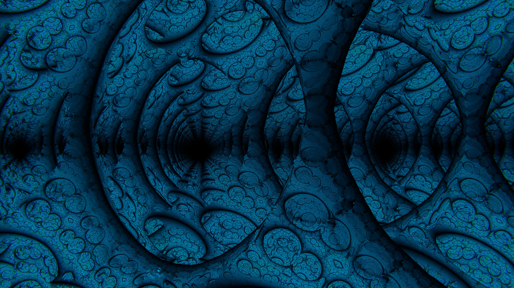
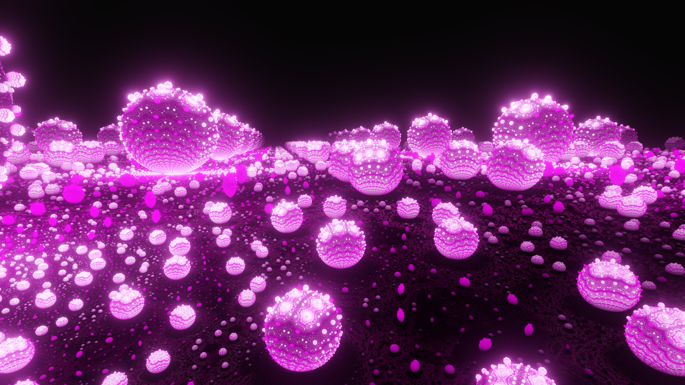
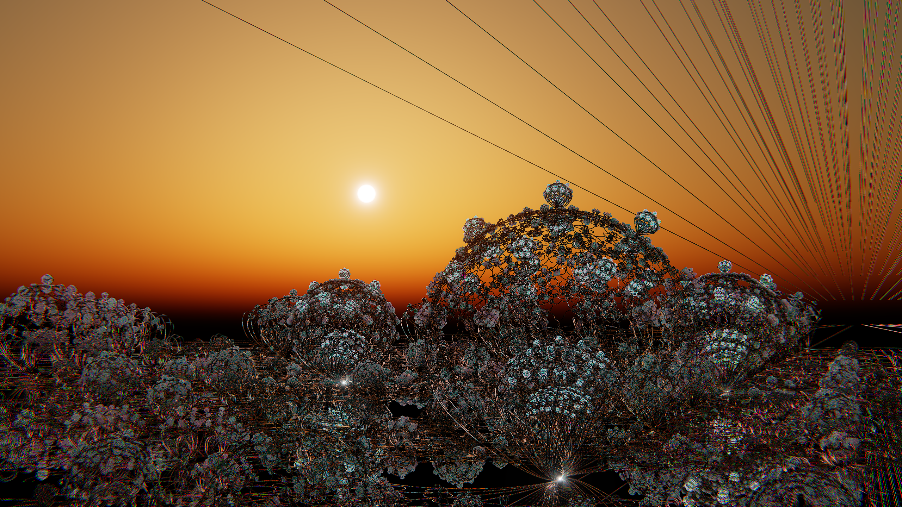
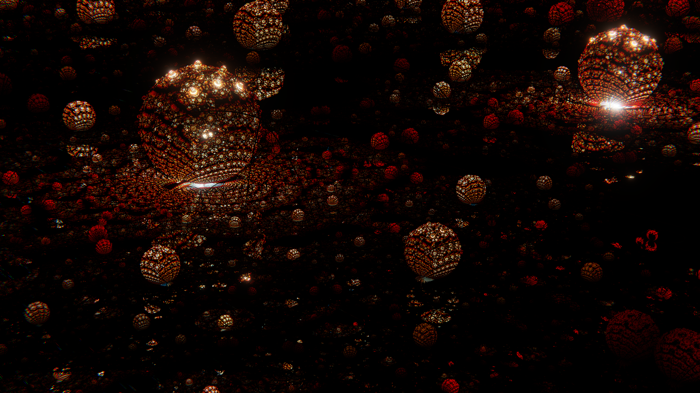

# fractalful

A real-time 3D fractal explorer written in Rust (wgpu + egui). Fly through
Mandelbulbs, Mandelboxes, Kleinian and kaleidoscopic fractals, build your own
formulas from nodes, animate the camera, sync it to music, and export videos.

- **Node-based formulas**: material, world (sky, sun, fog) and processing
  (color grading, bloom, lens effects) graphs, compiled to WGSL on the fly
- **41 presets** in five categories: Classic, Materials, Animated, Infinite
  spaces, Landscapes
- **Timeline**: camera and node-parameter keyframes, song waveform with
  detected beats, Audio Level / Beat nodes
- **Output**: HDR10 / scRGB display support, screenshots, MP4 or PNG-sequence
  export with motion blur



## Download

Grab the latest zip from [Releases](https://github.com/rT0mmy/fractalful-rust/releases),
unzip it anywhere and run `fractalful.exe`. Nothing gets installed.

The build isn't code-signed, so Windows SmartScreen may warn you. Click
**More info → Run anyway**.

**Requirements:** Windows 10/11 64-bit, a GPU with Vulkan or DirectX 12.
On a laptop, run it on the dedicated GPU.

## Building from source

1. Install Rust (stable, 1.85 or newer for edition 2024) from <https://rustup.rs>.
   On Windows you also need the MSVC build tools; rustup offers to install them.
2. Clone and run:

   ```sh
   git clone https://github.com/rT0mmy/fractalful-rust.git
   cd fractalful-rust
   cargo run --release
   ```

   The executable ends up in `target/release/fractalful.exe`. Release builds
   link the C runtime statically, so the exe runs on machines without the
   Visual C++ Redistributable.
3. Run the tests (they validate every shader and preset) with:

   ```sh
   cargo test --release
   ```

Windows is the developed and tested platform. The code is mostly
cross-platform (wgpu, winit, cpal), but Linux and macOS builds are untested.

### Optional: ffmpeg for video export

MP4 export pipes frames into [ffmpeg](https://ffmpeg.org). fractalful looks
for `ffmpeg.exe` next to its own exe first, then on `PATH`. On Windows:

```sh
winget install Gyan.FFmpeg
```

PNG-sequence export works without it.

## Getting started

| Input | Action |
| --- | --- |
| Right mouse drag | look around |
| W A S D, Q / E | fly, down / up |
| Scroll | flying speed ±5% (Shift: ±25%) |
| Space | play / pause the timeline |
| N | node editor |
| Shift+A (node editor) | search and add a node |
| I | camera keyframe at the playhead |
| Tab / F11 / F12 | hide UI / fullscreen / screenshot |
| F1 | all shortcuts |

- **Presets:** *Controls → Fractal → Load preset*. The node editor's World and
  Processing tabs have their own *Load preset* menus for skies and looks.
- **Music:** drop an MP3, FLAC or WAV onto the window, then use the Audio
  Level and Beat nodes to drive any parameter.
- **Projects:** saved to `Documents\fractalful\projects` (screenshots and
  videos go next to it). The last session restores automatically.
- **Crashes:** details go to `%APPDATA%\fractalful\crash.log`. Deleting
  `%APPDATA%\fractalful\session.json` starts you fresh.

## Screenshots






## License

Not chosen yet. Third-party crate licenses are listed in
`THIRD_PARTY_LICENSES.txt` inside each release zip.
